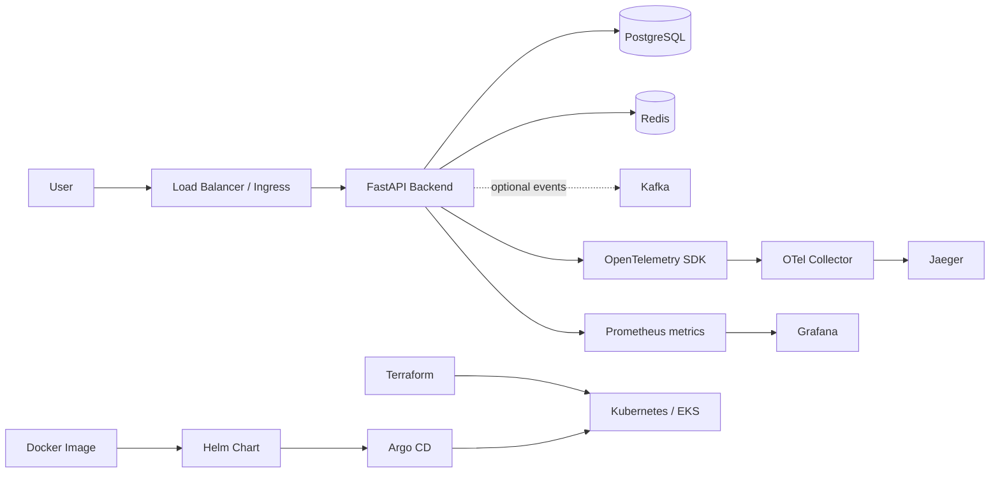

# Cloud-Native Observability Platform

A portfolio-ready starter project based on the uploaded architecture: Docker images, FastAPI backend, PostgreSQL, Redis, Kafka, Prometheus, Grafana, OpenTelemetry, Jaeger, Helm, Argo CD, Kubernetes, and Terraform.

## What works in this starter

- REST API with health/readiness endpoints, CRUD-style task endpoints, structured logging, Prometheus metrics, and OpenTelemetry traces.
- PostgreSQL persistence and Redis caching.
- Docker Compose local environment.
- Prometheus scrape configuration and a Grafana provisioning datasource.
- OpenTelemetry Collector exporting traces to Jaeger.
- Kubernetes manifests and a Helm chart.
- Argo CD application definition.
- Terraform AWS foundation example (VPC, public/private subnets, EKS-ready outputs; review before applying).
- Optional Kafka and OpenSearch services via Compose profiles.

> This is a learning/portfolio starter, not a production-ready deployment. Add secrets management, TLS, authentication/authorization, backups, network policies, resource limits, and production-grade Kafka/OpenSearch configuration before real use.

## Architecture



## Prerequisites

- Docker Desktop or Docker Engine + Compose plugin
- Python 3.11+ only if running the API outside Docker
- `kubectl`, Helm, and Terraform for the optional Kubernetes/cloud stages

## Run locally

```bash
cp .env.example .env
docker compose up --build -d
docker compose ps
```

Open:
- API docs: http://localhost:8000/docs
- Health: http://localhost:8000/health
- Readiness: http://localhost:8000/ready
- Prometheus metrics: http://localhost:8000/metrics
- Prometheus: http://localhost:9090
- Grafana: http://localhost:3000 (default local credentials: admin / admin; change them in `.env`)
- Jaeger UI: http://localhost:16686

Try the API:

```bash
curl http://localhost:8000/health
curl -X POST http://localhost:8000/tasks \
  -H 'Content-Type: application/json' \
  -d '{"title":"Build observability demo","description":"Add traces and metrics"}'
curl http://localhost:8000/tasks
```

Stop the environment:

```bash
docker compose down
# Remove local database data too:
docker compose down -v
```

## Optional components

Kafka and OpenSearch are resource-intensive. Start them only when needed:

```bash
docker compose --profile messaging up -d
docker compose --profile search up -d
```

Kafka is included as an infrastructure learning target; the API does not publish to it by default. OpenSearch is included as a logging/search target; application logs remain stdout by default.

## Tests

```bash
python -m venv .venv
# Windows: .venv\\Scripts\\activate
# Linux/macOS: source .venv/bin/activate
pip install -r requirements.txt
pytest -q
```

Tests that require external PostgreSQL/Redis are not run by default; unit tests cover API-independent logic. For an end-to-end test, run Compose and use the curl commands above.

## Kubernetes / Helm

```bash
kubectl create namespace observability-demo
helm upgrade --install platform ./helm/platform -n observability-demo \
  --set image.repository=YOUR_DOCKERHUB_USER/observability-backend \
  --set image.tag=latest
```

The chart expects PostgreSQL and Redis endpoints to be supplied through values or environment overrides. For a real cluster, use managed database/cache services and Kubernetes Secrets rather than the sample local defaults.

## Argo CD

Update `argocd/application.yaml` with your Git repository URL and path, then apply it:

```bash
kubectl apply -f argocd/application.yaml
```

## Terraform

See `terraform/README.md`. Review cost, region, IAM, CIDRs, and module versions before `terraform apply`. The example provisions cloud networking only; it does not automatically create an EKS cluster.

## Suggested portfolio milestones

1. Run Compose and capture screenshots of API docs, Prometheus, Grafana, and Jaeger.
2. Add CI with tests, Docker build, Trivy scan, and image publishing.
3. Push the image to Docker Hub or a cloud registry.
4. Deploy with Helm to a local Kubernetes cluster, then EKS.
5. Configure Argo CD for GitOps.
6. Add dashboards, alert rules, log collection, secrets management, and load testing.
